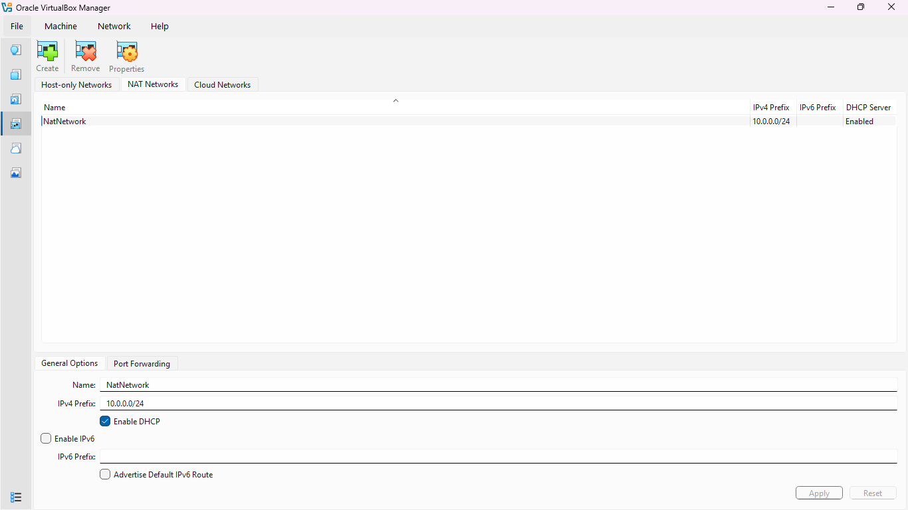
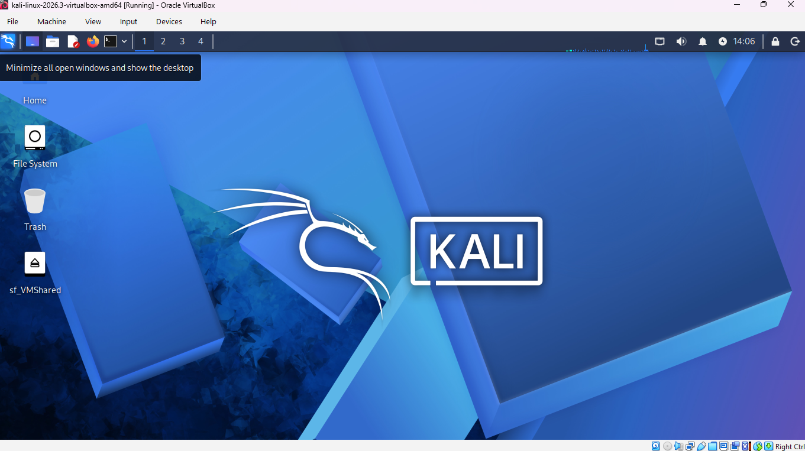
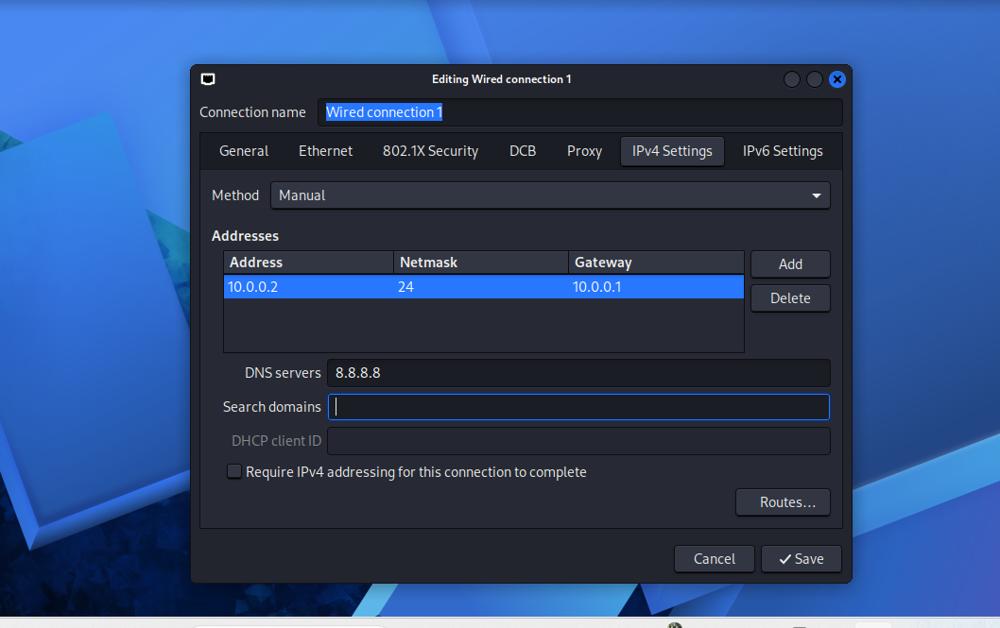
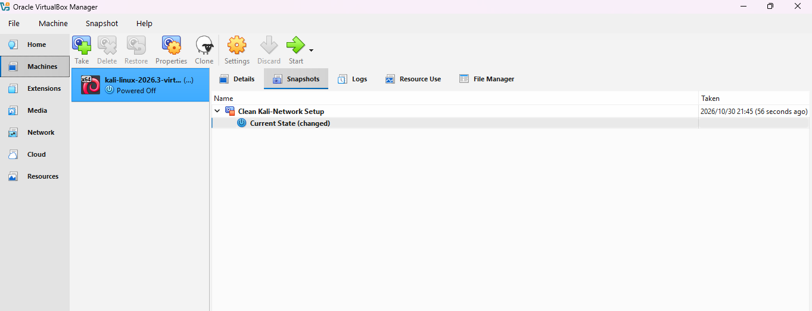

<h1 align="center"> Cybersecurity Lab Environment Setup</h1>

<p align="centre">A private virtual lab using VirtualBox and Kali Linux for ethical hacking practice.</p>

## 📌Project Overview
This project focuses on building a virtual cybersecurity testing laboratory using VirtualBox and Kali Linux.

The environment is intended to support the repeatable, risk-free practice of security tooling, network scanning, and vulnerability assessment.

---

## 🎯 Objectives

The main objectives of this project are to:

- Install and configure VirtualBox.
- Create a private NAT network for the cybersecurity lab.
- Install/import Kali Linux as a virtual machine.
- Configure network connectivity for Kali Linux.
- Assign a consistent IP address to the Kali VM.
- Verify network connectivity and DNS resolution.
- Take a clean VM snapshot for recovery.
- Document the setup process.

---

## 🛡️ Purpose of the Lab

This lab offers a secure, self-contained environment for learning cybersecurity and carrying out authorized security tests.

It can be used for activities such as:
- Host discovery and device mapping on a network
- Vulnerability assessment
- Packet analysis
- Web security testing

---

## 🏗️ Lab Architecture

```text
Host Machine (Windows 11)
        |
Oracle VirtualBox
        |
NAT Network (10.0.0.0/24)
        |
        +-- Kali Linux VM (ATTACKER) 10.0.0.15
        |
        +-- Victim / Target VMs 

NAT Network ---> Host ---> Internet
```
---

## ⚙️ Lab Configuration

| 🧩 Component | ⚙️ Configuration |
|---|---|
| 🖥️ Host OS | Windows 11 |
| 🧠 Host RAM | 16 GB |
| ⚡ Processor | Intel Core i5 |
| 🧰 Hypervisor | VirtualBox 7.2 |
| 🐉 Security OS | Kali Linux 2026.2 |
| 🧠 Kali RAM | 2048 MB |
| 🌐 Virtual Network | NAT Network |
| 📡 Network Address | 10.0.0.0/24 |
| 🐧 Kali IP Address | 10.0.0.15/24 |
| 🚪 Default Gateway | 10.0.0.1 |
| 🌍 DNS Server | 8.8.8.8 |

## Lab Setup Procedure
## Step 1 Install 7-Zip 
7-Zip was installed to extract the Kali Linux virtual-machine package

## Step 2 Install VirtualBox

## Step 3 Create the NAT network
Configuration: Network Name: NatNetwork IPv4: 10.0.0.0/24 DHCP: Enabled IPv6: Disabled



A NAT Network was selected because multiple virtual machines connected to the same NAT Network can communicate with one another,
allowing future attacker and target VMs to communicate within the lab.

## Step 4 Import Kali Linux
The Kali Linux virtual machine was downloaded from the official Kali Linux website and imported into VirtualBox.



## Step 5 Configure the Kali Linux network



## Step 6 Check for internet connectivity
The following command was ran in the Kali Linux command prompt to check for internet connectivity:

```bash
ip a
ping -c 4 google.com
```

.png)

The internet connection was a success.

## Step 7 Create a clean VM snapshot
After initial configuration, a snapshot named Clean Kali-Network Setup was taken



## Problems Encountered
**No IPv4 address and DHCP timeouts:** Kali showed "Disconnected", `ip a` listed no IPv4 address, and `nmcli` reported that the IP configuration
could not be reserved. A static address (`10.0.0.2`) did not work, so a different one (`10.0.0.15/24`) was assigned with `nmcli`, which restored internet access.

## What I learned
I learned how to create and configure a virtual environment for cybersecurity practice. The following are also takeaways from this lab:

# 1. Lower IP Addresses
Addresses at the start of a NAT Network range can conflict with reserved addresses, so choosing a higher address avoids problems

# 2. VM Snapshots
Creating a clean snapshot before a high-risk or experimental activity provides good recovery point for later security exercises.

# 3. Static IP Configuration
This project built my skills in configuring and validating IPv4 addressing, subnet masks, gateways, and DNS settings on Kali Linux.

# 4. Documentation
Thorough documentation of commands, configurations, screenshots, problems, and solutions is key in cybersecurity work.

## Security and Ethical use
The purpose of this laboratory is only intended for education purposes

## 🔗 Tools & Resources

- **7-Zip:** https://7-zip.org/download.html
- **VirtualBox:** https://virtualbox.org/wiki/Downloads
- **Kali Linux:** https://kali.org/get-kali

## Project Information
Cybersecurity at Networkwalks | Week 01 | Project: Cybersecurity & Pentesting Lab Setup | Repository : Github

## 👤 Author

**Matebang Sekoati**  
Cybersecurity Intern B084  
Cybersecurity at Networkwalks

LinkedIn: https://www.linkedin.com/in/matebang-sekoati-70b68a24b


